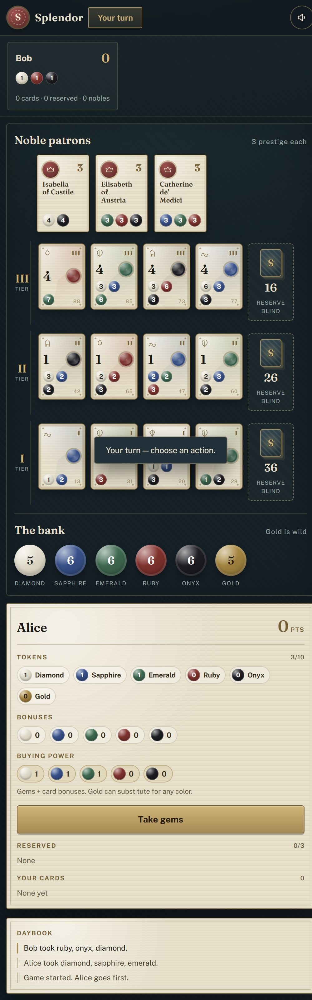

# Splendor — Local Network Edition

A self-hosted, browser-based version of the board game **Splendor** (base game,
2–4 players). One laptop runs the server; everyone else joins from their phone
over the same Wi-Fi by opening a link you share with them.

No accounts, no internet, no installs beyond Python.



---

## Quick start

Clone and run in one line:

```bash
git clone https://github.com/Srivar-Burla/splendor.git && cd splendor && python3 server.py
```

Then open the printed `http://<lan-ip>:8000` link. On Windows, use
`start.bat` instead of `python3 server.py`.

---

## Requirements

- **Python 3.9 or newer** (tested on 3.14)
- All players on the **same Wi-Fi / LAN** as the host laptop

The server uses only the Python standard library — there is nothing to `pip install`.

---

## Run it

### Windows (easiest)

Double-click **`start.bat`**. It starts the server and opens the game in your
default browser automatically.

### macOS / Linux

```bash
cd splendor
chmod +x run.sh
./run.sh
```

Or run `python3 server.py` and open `http://127.0.0.1:8000` yourself.

### Or from a terminal

```bat
cd splendor
python server.py
```

You'll see something like:

```
  SPLENDOR  -  local network game
  ----------------------------------------------
  This laptop:        http://127.0.0.1:8000
  Share this link:    http://192.168.1.42:8000
  ----------------------------------------------
```

Open the **Share this link** URL on your own laptop first, then paste that
same link into the group chat. Everyone on the Wi-Fi can open it.

### Options

```bat
python server.py --port 9000
```

If port 8000 is already in use, pick another one.

---

## Sharing it with others

Zip the `splendor` folder and send it. Each person needs:

- **Python 3.9+** installed
- To extract the folder
- To run `start.bat` (Windows) or `./run.sh` (macOS/Linux)

There is nothing to `pip install` — the server uses only the standard library,
and the fonts are bundled so it works offline.

The share link is different on each home network. The server prints it on
startup, and the lobby shows it too. The lobby also shows a **QR code** of that
link, so nearby players can scan it with their phone camera. If Windows Firewall
prompts, allow Python on private networks.

---

## Stopping the server

- **From the game:** the host can click **Stop server** in the topbar (or the
  lobby) and confirm. Everyone is disconnected and the server exits.
- **From Windows:** double-click **`stop.bat`** to kill the process on port 8000.
- **From the terminal:** press Ctrl+C in the server window. If the window is
  stuck, use `stop.bat`.

---

## How the lobby works

1. The first person to open the link becomes the **host**.
2. Everyone else joins with a name (2–4 players). Nearby players can also scan
   the **QR code** shown in the lobby instead of typing the link.
3. The host presses **Start game**.
4. From that moment the lobby is **locked** — new players are rejected.
5. If a phone sleeps or drops Wi-Fi, that player can reopen the link and is
   returned to their seat automatically (the browser stores a private token).

After a game ends, the host can **Play again** (same players) or **Back to
lobby** (reopens joins).

---

## How to play (quick reference)

Each turn, do exactly **one** of:

| Action | Details |
|---|---|
| **Take 3 gems** | Three tokens of different colors. |
| **Take 2 gems** | Two of the same color — only if the bank has at least 4. |
| **Reserve a card** | Take a face-up card (or blind from a deck) plus 1 gold. Max 3 reserved. |
| **Buy a card** | Pay its cost with tokens and/or your permanent bonuses. Gold is wild. |

- Cards give a **permanent gem bonus** and sometimes **prestige points**.
- **Nobles** are worth 3 points and visit you automatically when your bonuses
  meet their requirement (you choose if several qualify).
- The game ends when someone reaches **15 prestige**; finish the round so
  everyone has had the same number of turns.
- Ties: fewest development cards, then fewest reserved cards.

The UI enforces all of this. Tap a card to buy or reserve it; tap **Take gems**
to pick tokens.

---

## Rules notes / design decisions

- **2 / 3 / 4 players** use **4 / 5 / 7** tokens of each gem color, plus 5 gold.
- **10-token hand limit:** an action that would leave you above 10 tokens is
  rejected (the UI explains why). This is a common digital simplification; the
  physical game lets you take tokens and then discard down to 10.
- **Reserved cards** are hidden from opponents (only the count is shown).
- **Blind reserves** are secret; face-up reserves are also hidden in this build.
- **Pass** appears only when you genuinely have no legal move (rare edge case).
- **Host skip:** if the current player is disconnected, the host can skip their
  turn so the game doesn't stall.

### Quality of life

- **Turn notification:** a toast, a short chime, and an optional system
  notification when it becomes your turn. The speaker and bell buttons in the
  topbar control sound and notifications.
- **Background recovery:** when you return to the tab, the board refreshes and
  the live connection reconnects automatically.
- **Buying power:** your ledger shows gems + card bonuses per color.
- **Buy preview:** the card dialog shows exactly what you'll spend after bonuses,
  including any gold used to cover the shortfall.
- **Blind reserve confirmation:** reserving from a deck asks first.
- **Public information:** opponents' buying power (gems + bonuses), coins,
  bonuses, prestige, card count, and nobles are visible, as they would be on a
  physical table. Reserved cards stay hidden.

---

## Troubleshooting

**Phones can't reach the link**
- Make sure everyone is on the same Wi-Fi (not guest Wi-Fi, not mobile data).
- Allow Python through **Windows Defender Firewall** when prompted. If you
  dismissed the prompt, add an inbound rule for TCP port 8000.
- Some routers/guest networks enable **AP isolation / client isolation**, which
  blocks devices from talking to each other. Turn it off or use a different
  network.
- Confirm the printed IP matches your laptop's LAN address (`ipconfig`).

**Port already in use**
```bat
python server.py --port 8080
```

**A player got locked out**
The host must finish the game and choose **Back to lobby**, or restart the
server (which resets everything).

**Server restarted mid-game**
State is in memory only. A restart starts a fresh lobby; players' stored tokens
become invalid and they'll be asked to join again.

---

## Design

The interface is built around one idea: **the assayer's table** — ink-blue felt,
parchment ledgers, brass rules, wax seals, and faceted gems. Type is **Fraunces**
(display) and **Public Sans** (UI), bundled locally so the game works offline.

Design guidance lives in `.opencode/skills/`:

- `frontend-design` (Anthropic) — distinctive visual direction
- `web-design-guidelines` (Vercel) — accessibility and interaction audit
- `ui-ux-pro-max` — searchable palette, type, and UX database

---

## Development

### Live reload

While the server is running, changes to the static UI files are picked up
automatically. Each client checks the file sizes every few seconds and reloads
when they change. The game state lives on the server, so a reload rejoins the
same game. Add `?live=0` to the URL to disable it.

---

## Project layout

```
splendor/
  server.py          HTTP server, lobby, SSE realtime, LAN IP detection
  game.py            Splendor rules engine
  data.py            90-card deck + 10 nobles
  static/
    index.html
    base.css         tokens, paper, seals, buttons, gems
    screens.css      join + lobby
    game.css         table, nobles, cards, deck
    bank-side.css    bank, player ledger, daybook
    overlays.css     modals, settlement, responsive, motion
    fonts.css        bundled @font-face rules
    fonts/           Fraunces + Public Sans WOFF2
    app.js           client state, API, SSE
    ui.js            screens and sections
    ui-parts.js      cards, nobles, panels, modals
    actions.js       click/submit handlers
  tools/
    fetch_fonts.py   re-download the bundled typefaces
  test_game.py       rules unit tests
  test_playthrough.py randomized full games
  test_server.py     HTTP/lobby tests
  test_sse.py        realtime stream test
  start.bat          Windows launcher
```

Run the tests:

```bat
python test_game.py
python test_playthrough.py
python test_server.py
python test_sse.py
```

---

## Notes

This is an unofficial fan implementation for private game nights. Splendor is a
trademark of Space Cowboys / Asmodee. Card costs and noble requirements are
functional game rules reproduced for interoperability.
